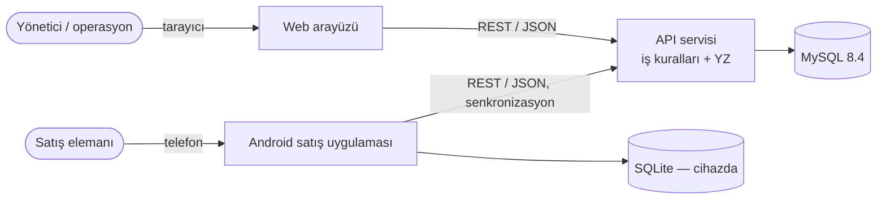
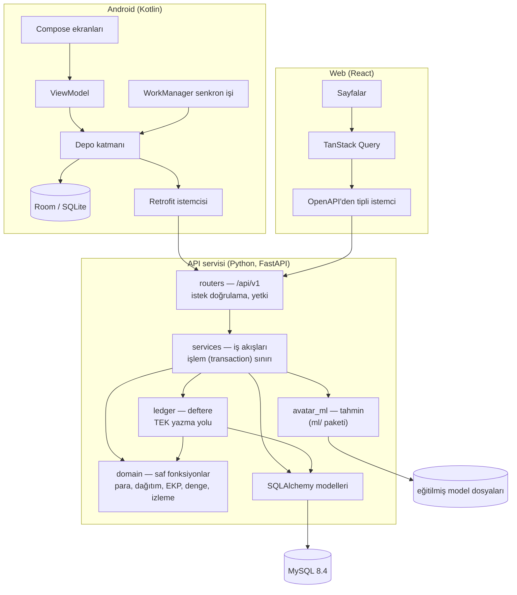
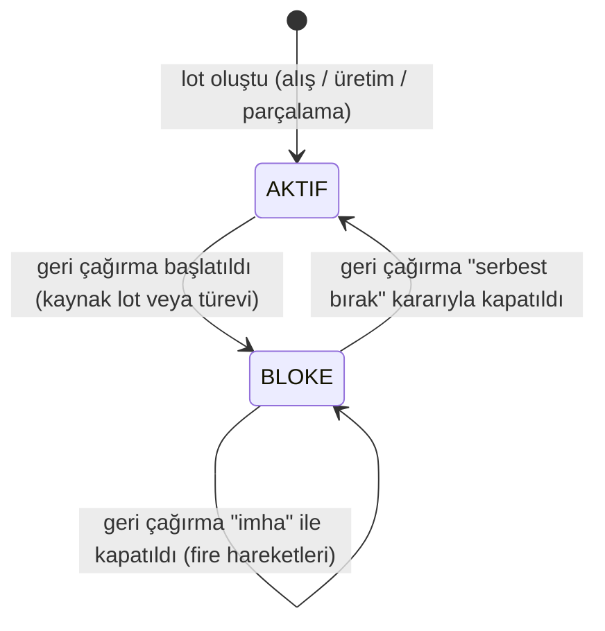
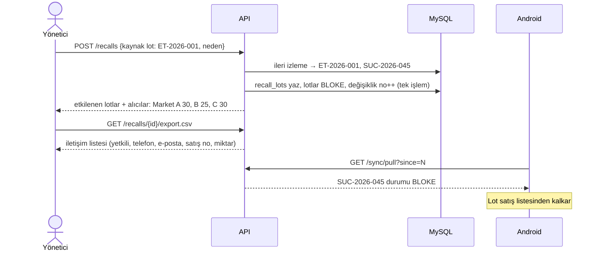
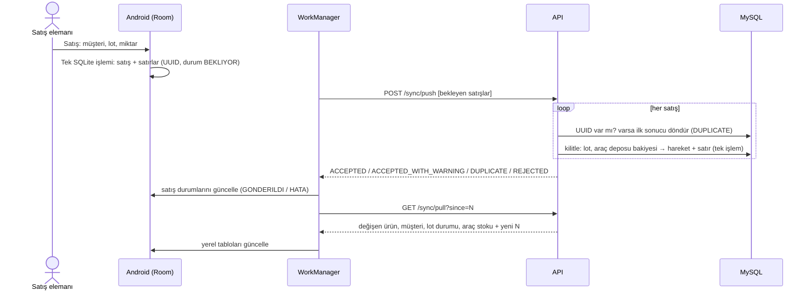
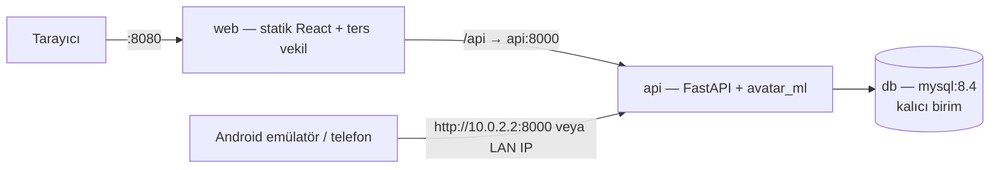

# Mimari

| | |
|---|---|
| Sürüm | v0.1 |
| Tarih | 24 Ekim 2026 |
| Durum | Taslak — ekip incelemesi bekliyor; kod henüz yok |
| Dayanak | ADR-001…007 (kabul edildi), ADR-008 (bu tasarımla önerildi) — `docs/decisions/`; `requirements.md` v0.1 |
| Eşlik eden belgeler | `data_model.md` (tablolar, ER diyagramı, değişmezler), `api.md` (uç noktalar) |

Bu belge sistemin **nasıl** çalışacağını anlatır: bileşenler, iş kuralları, akışlar, senkronizasyon, YZ bağlantısı, hata yönetimi, güvenlik ve çalıştırma. Tablo ayrıntıları `data_model.md`'de, uç nokta ayrıntıları `api.md`'de; burada tekrar edilmez.

---

## 1. Sistem bağlamı



- **Yönetici / operasyon** web arayüzünden çalışır: ana veriler, alış, dış üretim, parçalama, transfer, izleme, geri çağırma, raporlar.
- **Satış elemanı** Android uygulamasıyla kendi araç deposundan müşterilere (marketlere) satış yapar; bağlantı yokken de çalışır.
- Dış sistem bağlantısı yok. Tedarikçi, dış üretici ve müşteriler sistemde **kayıt** olarak bulunur, kullanıcı olarak değil.

## 2. Bileşenler ve sorumluluklar



| Bileşen | Sorumluluk | Sorumlu olmadığı |
|---|---|---|
| `routers` | URL, istek/yanıt şemaları (Pydantic), kimlik ve rol denetimi | İş kuralı |
| `services` | Bir iş akışını baştan sona yürütmek (ör. "mamul kabulü"); **her akış tek veritabanı işlemi** (NFR-003) | SQL ayrıntısı, yuvarlama |
| `ledger` | Stok hareketi yazmanın tek yolu: lot zorunluluğu, bloke denetimi, eksi stok denetimi, değerleme kuralı, bakiye ve lot özetini güncelleme | Belge (alış, satış…) oluşturma |
| `domain` | Veritabanından bağımsız saf hesaplar: `money` (yuvarlama), `allocation` (dağıtım), `costing` (EKP), `balance` (ağırlık dengesi), `graph` (izleme gezinmesi) | Kalıcılık |
| `avatar_ml` | Özellik hazırlama, model yükleme, tahmin; eğitim ve değerlendirme betikleri | İş kuralı, veritabanı |
| Web | Ekranlar, formlar, raporlar; iş kuralı **yok** (hepsi API'de) | Hesaplama |
| Android | Satış akışı, yerel saklama, senkronizasyon, bloke lotun gizlenmesi | Maliyet hesabı (maliyeti sunucu hesaplar) |

Bilinçli sadelik: ayrı bir "repository" soyutlama katmanı yok; SQLAlchemy zaten bu işi görüyor (KISS). Hesap kuralları `domain` içinde saf fonksiyon olduğu için veritabanısız birim testi yapılabiliyor.

---

## 3. Temel iş kuralları

### 3.1 Stok hareket defteri (ADR-008)

- Stok yalnızca `stock_movements` tablosuna satır eklenerek değişir. Satırlar **güncellenmez ve silinmez**. Bunu uygulama kuralı olmanın ötesinde MySQL tetikleyicileri de engeller. Hata **ters kayıtla** düzeltilir: aslının miktar ve değerinin tam tersi, `reversal_of_id` ile bağlı.
- Her hareketin **lotu, ürünü ve deposu zorunludur** (FR-303). Miktar işaretlidir: giriş +, çıkış −.
- `ledger.post()` dışında hiçbir kod bu tabloya yazmaz. Alış, dış üretim, parçalama, satış, iade, transfer ve fire bu fonksiyonu çağırır.
- Hızlı okuma ve eşzamanlılık için iki **özet** tutulur; ikisi de hareketle **aynı işlemde** güncellenir:
  - `stock_balances(lot, depo) → miktar` — depo bazında eksi stok denetimi
  - `lots.remaining_qty / remaining_value` — lot bazında değerleme
- **Kilit sırası** (kilitlenme/deadlock önlemi): önce lot satırı (`SELECT … FOR UPDATE`), sonra bakiye satırı. Böylece iki eşzamanlı satış aynı stoku iki kez düşemez.
- Defterin özetlerle tutarlılığı sekiz değişmezle tanımlıdır (`data_model.md` §5) ve **bütünlük raporu** ile her an denetlenebilir (FR-607).

### 3.2 Lot değerleme (ADR-006, ADR-008)

Her lotun bir **kalan miktarı** ve **kalan değeri** vardır. Maliyet lot düzeyinde izlenir; ortalama maliyet kullanılmaz ("gerçek maliyet").

| Hareket | Değer kuralı |
|---|---|
| Lotu oluşturan giriş (alış, üretim, parçalama) | Belgeden gelen kesin tutar (fatura + ek maliyetler; tüketim + hizmet; dağıtılan pay) |
| Transfer (depo değiştirme) | **0** — lotun değeri değişmez, yalnız yeri değişir |
| Değerli çıkış (tüketim, satış, fire) | Kalan değer × çıkan miktar / kalan miktar, kuruşa yuvarlanır; **çıkış lotu sıfırlıyorsa kalan değerin tamamı** |
| Müşteri iadesi | İade edilen satırın maliyetinden orantılı pay |

Sonuç: Satış maliyetlerinin toplamı lot değerine kuruşu kuruşuna eşittir. Doğrulamada SUC-2026-045 için 544,76 + 453,97 + 544,77 = **1.543,50 €** çıktı (§14).

### 3.3 Lot ağı ve izleme

- Bir süreç girdi lotlarını tüketip çıktı lotu ürettiğinde, her girdi–çıktı çifti için `lot_links` satırı yazılır: ebeveyn lot, çocuk lot, **miktar**, süreç türü ve kimliği (FR-302).
  - **Dış üretim / yeniden işleme:** girdi lotları (et, baharat, bağırsak) → tek mamul lotu. Bir emir bir çıktı lotu üretir. Bir hammadde lotu farklı emirlerde kullanılarak birden çok mamul lotuna dönüşebilir.
  - **Parçalama:** giriş lotu → her parça ve yan ürün için ayrı lot. Firenin lotu yoktur; işlem kaydında miktarıyla durur.
- **İleri / geri izleme:** `domain.graph` katman katman gezinir (ziyaret edilenler kümesi döngüye karşı korur). Bulunan lotlar için:
  - ileri yönde: depo bakiyeleri, satış satırları (müşteri, miktar, satış no), iadeler, kayıtlı ikinci kademe teslimatlar
  - geri yönde: alış satırları (tedarikçi, belge), üretim emirleri, parçalama kayıtları
- **Kesinlik ilkesi (CON-003):** İzleme yalnızca kayıtlı bağlardan sonuç üretir. İkinci kademe teslimat (`onward_deliveries`) kaydedilmişse "kesin" gösterilir. Kaydedilmemişse alıcı "bilinen son alıcı — sonrası bilinmiyor" olarak işaretlenir (FR-308). Hiçbir yerde tahmin kullanılmaz.

### 3.4 Maliyet hesapları

- **Dış üretim EKP (FR-110):** mamul lot değeri = Σ (tüketim hareketlerinin değeri) + hizmet tutarı; EKP = mamul lot değeri / teslim alınan miktar. Hesap dökümü ayrı tabloda tutulmaz; tüketim hareketlerinden ve emirdeki hizmet tutarından her zaman yeniden okunur (tek kaynak, DRY).
- **Hizmet faturası:** Önerilen tutar teslim alınan adet × birim hizmet ücretidir. Fatura tutarı farklı girilirse açıklama zorunludur (FR-207 ile aynı kural).
- **Parçalama dağıtımı (FR-206):** ağırlık = kg × katsayı. Katsayı miktar ağırlıklı yöntemde 1, değer ağırlıklı yöntemde reçete satırının €/kg değeridir; maliyet taşımayan satırda 0'dır. Fire her zaman 0'dır. Pay, en büyük kalan yöntemiyle kuruşa dağıtılır; eşitlikte reçete sırası belirler. Σ pay = toplam maliyet bir değişmezdir.
- **Ağırlık dengesi (FR-205):** |giriş kg − Σ çıkış kg (parça + yan ürün + fire)| ≤ reçetenin toleransı (varsayılan önerimiz 0,2 kg). Denge yoksa onay reddedilir (`WEIGHT_IMBALANCE`).
- **Tutar tutarlılığı (FR-207):** Alış satırında `kuruşa yuvarlanmış(miktar × birim fiyat)` ile fatura tutarı farklıysa açıklama zorunludur. Lot değeri = fatura tutarı + ek maliyet kalemleri (nakliye, kesim …). Örnek: 25 kg × 11,50 € = 287,50 € mal bedeli + 63,50 € kesim/nakliye = 351,00 €.

### 3.5 Lot durumu ve geri çağırma



| Bloke lotta işlem | Kural |
|---|---|
| Satış (web), transfer, üretimde/parçalamada kullanım | **Reddedilir** — `LOT_BLOCKED` (FR-310) |
| Android'den gelen, çevrimdışıyken yapılmış satış | **Kaydedilir**, satış "geri çağırma ihlali" işaretlenir, uyarı üretilir, müşteri iletişim listesine girer (ADR-004) |
| Müşteri iadesi | İzinli — mal geri gelir, lot bloke kalır |
| Fire (imha) | İzinli |

Geri çağırma başlatılınca (FR-306): kaynak lottan ileri izleme yapılır, bulunan **bütün** lotlar `recall_lots` tablosuna o anki derinlikleriyle yazılır ve `BLOKE` olur. Hepsi tek işlemdedir. Lot satırları değiştiği için değişiklik numarası artar ve Android bir sonraki çekişte bunu görür. Geri çağırma raporu (FR-307) alıcıları, miktarları, satış belgelerini ve iletişim bilgilerini **canlı** hesaplar; böylece sonradan gelen ihlalli satışlar da listeye girer.

---

## 4. İş akışları

### 4.1 Dış üretim (Görev 1)

| Adım | Uç nokta | Ne olur (tek veritabanı işlemi) |
|---|---|---|
| 1. Emir | `POST /production-orders` | Emir `TASLAK`; planlanan girdiler (lot, miktar); **Model A tahmini** üretilip `ai_forecasts`'a kaydedilir |
| 2. Sevk | `POST /production-orders/{id}/ship` | Her girdi için ANA → DIS-URETICI transferi (değer 0); emir `SEVK_EDILDI` |
| 3. Mamul kabulü | `POST /production-orders/{id}/complete` | Teslim alınan miktar, iadeler (DIS-URETICI → ANA transferi), tüketim (`URETIM_TUKETIM`), hizmet tutarı, yeni mamul lotu (`URETIM_GIRIS`, değer = tüketim + hizmet), `lot_links`; emir `TAMAMLANDI` |
| 4. Sonuç | `GET /production-orders/{id}` | EKP, VKP, brüt kâr, marj; tahmin – gerçek – sapma; miktar farkları |

Bir cari "dış üretici" olarak kaydedilince ona ait `DIS_URETICI` deposu otomatik açılır (kod `DIS-<cari kodu>`); böylece web'den açılan yeni bir dış üreticiyle hemen emir açılabilir.

### 4.2 Parçalama (Görev 2)

| Adım | Uç nokta | Ne olur |
|---|---|---|
| 1. Taslak | `POST /cuttings` | Reçeteden çıkış satırları açılır; **Model B** her satır için beklenen kg'ı yazar |
| 2. Tartım | `PUT /cuttings/{id}` | Fiili kg'lar girilir (taslak, deftere yazılmaz) |
| 3. Ön izleme | `POST /cuttings/{id}/preview` | Ağırlık dengesi + dağıtım sonucu, kaydetmeden gösterilir |
| 4. Onay | `POST /cuttings/{id}/approve` | Tek işlemde: giriş lotundan `PARCALAMA_TUKETIM`, her parça/yan ürün için lot + `PARCALAMA_GIRIS` (değer = dağıtılan pay), `lot_links` |

Uygulama ayrıntıları (T-11): toplam maliyet, giriş lotundan çıkan değerdir (lotun tamamı parçalanırsa kalan değerin tamamı, kısmen parçalanırsa orantılı payı). Fiili ağırlığı 0 olan parça için lot açılmaz. Parça lotunun SKT'si kendi raf ömrüyle hesaplanır ama girdi lotunun SKT'sini geçemez. Lot bağındaki miktar, girdi lotundan o parçaya giden kg'dır. Taslakta ön izleme, ağırlıklar kaydedilmeden de istenebilir.

### 4.3 Geri çağırma (Görev 3)



### 4.4 Satış ve senkronizasyon

Bkz. §5.

---

## 5. Senkronizasyon (TR-007, ADR-004)



**Değişiklik numarası nasıl üretilir:** Tek satırlı `sync_counter` tablosu, değişiklik yapan her işlemde `UPDATE … SET value = value + 1` ile artırılır. Bu satır kilidi işlem bitene kadar tutulduğu için numaralar **işlenme sırasıyla** dağıtılır. Böylece "küçük numaralı değişiklik daha geç kaydedildi, cihaz onu atladı" sorunu yaşanmaz. Senkronize edilen tablolardaki (`products`, `partners`, `lots`, `stock_balances`) satır her değiştiğinde `change_seq` sütununa bu numara yazılır. Bu iş bir SQLAlchemy olay kancasıyla tek yerde yapılır (DRY). Demo ölçeğinde bu sıralamanın performans maliyeti önemsizdir.

**Sunucu sıfırlanırsa:** Değişiklik numarası yalnız ileri gittiği sürece artımlı çekme doğrudur. Veritabanı sıfırdan kurulursa ya da eski bir yedekten dönerse cihazın elindeki numara anlamını yitirir ve sunucuda artık olmayan kayıtlar cihazda kalır (T-09 denemesinde görüldü). Bu yüzden `sync_counter` satırı şema kurulurken bir veri kümesi kimliği (UUID) alır ve her çekme yanıtında gönderilir. Cihaz kimliği değişmiş görürse ya da `next_since` kendi numarasından küçükse tam kopyayı çeker ve yerel kopyayı tek SQLite işleminde onunla değiştirir; çekme başarısız olursa eski kopya durur.

**Cihazdaki kullanılabilir stok:** Sunucunun gönderdiği araç deposu bakiyesi, cihazdaki henüz gönderilmemiş satışları içermez. Bu yüzden cihazda gösterilen kullanılabilir miktar = sunucu bakiyesi − bekleyen satış miktarları. Aksi hâlde çekişten sonra çevrimdışı satılmış mal yeniden satılabilir görünürdü.

**Reddedilen satış:** Araç deposu modeli eksi stoku önler. Yine de sunucuda yapılan bir düzeltme yüzünden yetersiz stok çıkarsa satış `REJECTED` döner, cihazda "HATA" olarak kalır ve yöneticinin çözmesi için görünür olur; sessizce kaybolmaz.

**Cihaz kimliği ve deposu:** `SATIS` rolündeki her kullanıcıya bir araç deposu atanır. Sunucu, push'taki depo kimliği kullanıcının deposu değilse isteği reddeder (`FORBIDDEN`).

---

## 6. Yapay zekâ entegrasyonu (ADR-005)

- **Eğitim çevrimdışıdır:** `ml/` içindeki betik, `data/synthetic/` altındaki sentetik geçmişten modelleri eğitir, `ml/models/` altına model dosyası ve sürüm bilgisi yazar, değerlendirme raporunu `reports/` altına üretir. Sabit tohum kullanıldığı için sonuç yeniden üretilebilir. Değerlendiricinin modeli eğitmesi gerekmesin diye eğitilmiş küçük model dosyaları depoya konur.
- **Tahmin, iş anında kaydedilir:** Dış üretim emri açılırken Model A, parçalama taslağı açılırken Model B çağrılır. Girdi özellikleri, tahmin ve model sürümü `ai_forecasts` tablosuna yazılır. Gerçek sonuç geldiğinde ekran ve raporlar bu **kayıtlı** tahmini gösterir (sızıntı yok; FR-502, FR-504).
- **Model A çıktısı:** beklenen verim, beklenen paket sayısı ve beklenen EKP. EKP = (seçilen girdi lotlarının bilinen maliyeti + hizmet birim ücreti × beklenen paket) / beklenen paket.
- **Model B çıktısı:** reçetedeki her satır için beklenen kg; paylar 1'e tamamlanacak biçimde ölçeklenir.
- **Hata durumunda:** Model dosyası yoksa veya tahmin hata verirse iş akışı **durmaz**. Tahmin alanı "yok" olarak kaydedilir ve günlüğe uyarı yazılır. YZ, ana işlevin ön koşulu değildir.
- Ayrıca `POST /ai/production-forecast` ve `POST /ai/cutting-forecast` uçları, kayıt açmadan "ne olurdu" tahmini verir (demo ve web ekranları için). `GET /ai/evaluation` değerlendirme özetini döndürür.

---

## 7. Hata yönetimi

- İş kuralı ihlalleri `DomainError` alt sınıflarıyla fırlatılır. Her birinin sabit bir **kodu** ve Türkçe mesajı vardır. Tek bir hata işleyici bunları HTTP yanıtına çevirir (kod listesi: `api.md` §3).
- Servisler işlemi `with session.begin():` içinde yürütür. Herhangi bir hata **bütün işlemi geri alır**; yarım kayıt kalmaz (NFR-003, AT-10).
- API'de istek başına tek işlem vardır ve işlem **yanıt gönderilmeden önce** kaydedilir (`Depends(get_db, scope="function")`). Böylece istemci "başarılı" yanıtını aldığında veri herkese görünürdür; hemen ardından gelen istek (ör. yeni oturum belirteciyle) onu bulur. Bağlantılar READ COMMITTED yalıtımıyla açılır: her sorgu son kaydedilmiş veriyi görür; tutarlılık satır kilitleriyle sağlanır (ADR-008 kilit sırası).
- Beklenmeyen hatalar 500 döner. Yanıtta iç ayrıntı gösterilmez; günlüğe yığın izi ve istek kimliği yazılır.
- Web, hata kodunu form alanına veya bildirime çevirir. Android, satış ekranında anlaşılır Türkçe mesaj gösterir; senkron hatası olan satış listede kırmızı görünür.

## 8. Güvenlik

| Konu | Uygulama |
|---|---|
| Kimlik doğrulama | `POST /auth/login` → rastgele oturum belirteci. Sunucuda yalnız belirtecin özeti saklanır; `Authorization: Bearer` başlığıyla gönderilir. |
| Parola | Standart kütüphanedeki `hashlib.scrypt` ile tuzlu özet. |
| Yetki | `YONETICI`: her şey. `SATIS`: senkron uçları, kendi araç deposu, satış. Denetim router katmanında. |
| Girdi doğrulama | Pydantic şemaları: pozitif miktar, ondalık basamak sınırı, metin uzunlukları, tarih biçimi. |
| SQL enjeksiyonu | Yalnız ORM / parametreli sorgu. |
| CORS | Yalnız web arayüzünün adresi. Docker'da web ile API aynı adresten sunulduğu için (ters vekil) CORS gerekmez. |
| Gizli bilgiler | Ortam değişkenlerinden okunur; depoda yalnız `.env.example`. Demo kullanıcı parolaları README'de "yalnız demo" diye belirtilir. |
| Web oturumu | Belirteç `sessionStorage`'da tutulur (sekme kapanınca biter, sayfa yenilenince sürer). Web yalnız `YONETICI` rolüne açıktır; satış kullanıcısı girişte Türkçe uyarıyla reddedilir. "Çıkış" oturumu sunucuda da kapatır (`POST /auth/logout`). Herhangi bir istek 401 dönerse giriş ekranına dönülür. |
| Android oturumu | Belirteç uygulamaya özel SharedPreferences'ta tutulur (prototip: şifrelenmeden). Sunucu 401 dönerse belirteç silinir, kullanıcı giriş ekranına döner. |
| Android 17 yerel ağ izni | targetSdk 37 olan uygulamalar yerel ağ adreslerine (emülatörde 10.0.2.2, telefonda bilgisayarın yerel IP'si) ancak `ACCESS_LOCAL_NETWORK` çalışma anı izniyle erişebilir; izin yoksa TCP bağlantısı zaman aşımına uğrar. Uygulama izni yalnız sunucu adresi yerel ağdaysa girişte ister (`util/LocalNetwork.kt`). |

## 9. Günlük kaydı

Uygulama, satır başına bir JSON günlük yazar: zaman, seviye, istek kimliği, kullanıcı, olay. Şu iş olayları her zaman yazılır: geri çağırma başlatma/kapatma (WARNING), geri çağırma ihlali (WARNING), ters kayıt (INFO), YZ tahmin hatası (WARNING). Kişisel veri (telefon, e-posta) günlüğe yazılmaz.

## 10. Test edilebilirlik

| Katman | Nasıl test edilir |
|---|---|
| `domain` | Saf birim testleri; veritabanı yok (AT-01, AT-03, AT-04 hesapları) |
| `ledger` ve `services` | Docker'daki MySQL'e karşı entegrasyon testleri. Ayrı bir `avatar_test` veritabanı kullanılır (geliştirme/demo verisine dokunulmaz); test oturumu başında şema sıfırdan kurulur, her test kendi işleminde çalışır ve sonunda geri alınır |
| API | FastAPI test istemcisiyle uç nokta testleri |
| Kabul | `tests/` altında, örnek kayıtları yüklenmiş çalışan sisteme karşı senaryolar (AT listesi) |
| Android | Senkron ve satış mantığı için sahte API ile JUnit; Room için bellek içi veritabanı |
| YZ | Değerlendirme betiği; sabit tohumla yeniden üretilebilir metrikler |

## 11. Çalıştırma ve dağıtım (ADR-007)



- **Tek komut:** `docker compose up --build`. API açılışta önce veritabanının hazır olmasını bekler, sonra şema göçlerini (Alembic) uygular. Veritabanı boşsa `SEED_PROFILE` değişkenine göre örnek kayıtları yükler:
  - `base`: ana veriler (cariler, depolar, ürünler, demo kullanıcıları, parçalama reçetesi, belge sayaçları) — `data/seed/base.json`. Hammadde alışları stok defteri yazıldıktan sonra (T-07) eklenecek. Video çekiminde görevler canlı yapılır.
  - `demo`: `base` + Görev 1–3 senaryosu tamamlanmış hâlde. Değerlendirici ET-2026-001 izlemesini hemen görür.
- **Android:** API adresi derleme ayarıyla verilir (emülatör için `http://10.0.2.2:8000`). İmzalı APK GitHub "Release" ekine konur.
- **Yapılandırma:** `DATABASE_URL`, `SEED_PROFILE`, `CORS_ORIGINS`, `MODEL_DIR`, `LOG_LEVEL` — örnekleri `.env.example`'da.

## 12. Klasör yapısı (planlanan)

```text
backend/
  app/
    main.py            # FastAPI uygulaması, hata işleyici, router kaydı
    config.py          # ortam değişkenleri
    db.py              # oturum, işlem yardımcıları, değişiklik no kancası
    models/            # SQLAlchemy tabloları
    schemas/           # Pydantic istek/yanıt şemaları
    api/               # routers: auth, master, purchases, lots, transfers, production, cuttings,
                       #          sales, returns, adjustments, trace, recalls, reports, ai, sync
    services/          # aynı adlarla iş akışları + ledger.py
    domain/            # money.py, allocation.py, costing.py, balance.py, graph.py
    seed/              # data/seed okuyucu
  migrations/          # Alembic
  tests/
ml/
  avatar_ml/           # data_gen.py, features.py, train.py, evaluate.py, predict.py
  models/              # eğitilmiş model dosyaları + sürüm bilgisi
  tests/
web/src/
  api/                 # schema.d.ts (OpenAPI'den üretilir), client.ts (belirteç, hata biçimi), types.ts, queries.ts
  auth/                # oturum bağlamı ve giriş akışı
  pages/               # Ana veriler, Alış, Stok, Lotlar, Transfer, Dış üretim (T-10); Parçalama, İzlenebilirlik,
                       # Geri çağırma, Raporlar, Yapay zekâ sonra
  components/          # sayfa çerçevesi, pencere formu, durum etiketleri, bağlantı
  lib/                 # decimal.ts (BigInt ile ondalık hesap), format.ts (Türkçe biçimler), router.ts, rules.ts, labels.ts
android/app/src/main/java/.../
  data/local/          # Room varlıkları, DAO'lar
  data/remote/         # Retrofit arayüzü, DTO'lar
  data/repo/           # depo katmanı
  sync/                # WorkManager işi
  ui/                  # giriş, ana ekran, satış, satış geçmişi
  util/Money.kt        # kuruş ↔ BigDecimal
```

## 13. Bilinen sınırlamalar ve kapsam dışı

- Tek para birimi (€), net fiyatlar, KDV yok (AS-001).
- Bir üretim emri tek mamul lotu üretir.
- Ek maliyet kalemleri, lot tüketilmeye başlanmadan girilmelidir. Sonradan gelen masraf için değer düzeltme hareketi bu sürümde yok.
- Tedarikçiye iade akışı yok; gerekirse fire/imha ile kayda alınır.
- Tek şirket, tek dil (Türkçe arayüz).
- Kullanıcı yönetimi ekranı yok; kullanıcılar örnek kayıtlarla gelir.
- Android ile sunucu arasında HTTP (şifresiz) kullanılır; yerel ağ demosu içindir. Gerçek kurulumda HTTPS gerekir ve `network_security_config.xml`'deki izin kaldırılmalıdır.

## 14. Tasarım doğrulaması

Kod yazılmadan önce bu tasarımın sade bir kopyası (bellek içi SQLite, aynı değerleme ve izleme kuralları) şartname senaryolarıyla çalıştırıldı: `reports/design_validation/model_check.py`, çıktı `model_check_output.txt`. Sonuç: **20/20 kontrol geçti** (24.10.2026). Kontrol edilenler:

| Senaryo | Sonuç |
|---|---|
| AT-01 EKP | Toplam 1.543,50 €, gösterim 18,16 €, lot değeri 18,16 × 85 = 1.543,60 değil |
| Satış maliyetleri | 544,76 + 453,97 + 544,77 = 1.543,50 € (kuruş kayması yok) |
| AT-06 ileri izleme | ET-2026-001 → SUC-2026-045 → Market A 30, B 25, C 30; kalan 0 |
| AT-07 geri izleme | Et, baharat, bağırsak lotları ve tedarikçileri |
| AT-03 dağıtım | Miktar ağırlıklı 111,68 / 63,82 / 79,77 / 47,87 / 47,86; değer ağırlıklı 123,41 / 83,34 / 72,12 / 33,66 / 38,47; ikisi de 351,00 |
| AT-04 denge | Fire girilmeden 3 kg fark |
| Parçalama lot ağı | Kuzu lotundan 5 parça lotuna ileri izleme |
| AT-08 | İleri izlemedeki lotların bloke edilmesi (yalnız durum; kanal bazlı engeller ürün testlerinde) |
| AT-10 | Lot miktarı ve değeri = hareket toplamları; miktarı 0 olan lotun değeri 0; hareket güncellenemez; eksi stok reddedilir |
| AT-11 | Aynı UUID'li satış ikinci kez kayıt açmaz |

**Sınır:** Bu, tasarımın mantıksal tutarlılığının kanıtıdır, ürünün değil. MySQL'e özgü davranışlar (kilitler, tetikleyiciler, `DECIMAL`) ve API/Android katmanları ürün testlerinde ayrıca doğrulanacak. Betik T-07/T-08 testleri yazılınca emekliye ayrılacak.

## 15. Varsayılanla ilerlediğimiz küçük tasarım kararları

Ekip aksini söylemedikçe bu varsayılanlar geçerlidir:

| Konu | Varsayılan |
|---|---|
| Tartım toleransı | Reçete başına 0,2 kg |
| Android'de satış fiyatı | Liste fiyatı (VKP) gelir, satır bazında değiştirilebilir |
| Geri çağırma kapanışı | "İmha" ve "serbest bırak" seçenekleri |
| Lot numaraları | Alış: kullanıcı girer. Dış üretim: `<ürün öneki>-<yıl>-<emir sırası>` (ör. SUC-2026-045), değiştirilebilir. Parçalama: `<parça kodu>-<parçalama no>` (ör. BUT-PRC-2026-012) |
| Belge numaraları | `URT-`, `PRC-`, `SAT-`, `TRF-`, `IAD-`, `GC-` + yıl + sıra |
