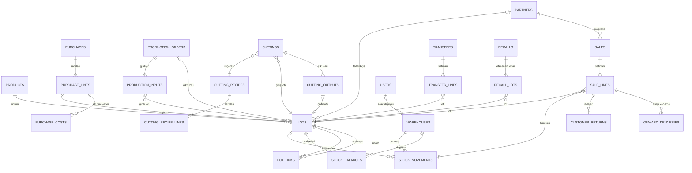

# Veri Modeli

| | |
|---|---|
| Sürüm | v0.2 — şema uygulandı (T-06): `backend/app/models/`, ilk göç `backend/migrations/versions/20261024_df3690a4b5d8_ilk_sema.py`; 31 tablo |
| Tarih | 24 Ekim 2026 |
| Karşıladığı teslimat | CR-007 "Veri modeli" |
| Dayanak | `architecture.md` §3, ADR-006, ADR-008 |

**Ortak kurallar.** Her tabloda `id BIGINT` birincil anahtar vardır. Belge tablolarında `created_at DATETIME(6)` ve `created_by → users` alanları da bulunur. Para alanları `DECIMAL(14,2)`, birim fiyat/ücret `DECIMAL(14,4)`, birim maliyet `DECIMAL(14,6)`, miktar `DECIMAL(12,3)`; miktar ürünün temel biriminde (kg veya adet) tutulur. Kayan noktalı tip hiçbir sütunda kullanılmaz (ADR-006). Durum ve tür alanları `ENUM` tipindedir.

---

## 1. ER diyagramı (ilişkiler)

Diyagramda okunurluk için yalnız ilişkiler gösterildi; sütunlar §2'de.

## 2. Tablolar

### 2.1 Ana veriler ve kullanıcılar

| Tablo | Alanlar | Kısıtlar ve notlar |
|---|---|---|
| `users` | username, password_hash, full_name, role (`YONETICI`/`SATIS`), warehouse_id, active | username tekil. `SATIS` rolünde warehouse_id zorunlu (araç deposu). |
| `sessions` | token_hash, user_id, created_at, expires_at | Belirtecin kendisi değil, özeti saklanır. |
| `products` | code, name, kind (`HAMMADDE`/`MAMUL`/`PARCA`/`YAN_URUN`), base_unit (`KG`/`ADET`), unit_weight_kg, lot_prefix, default_purchase_price (FR-101; gerçek fiyat lotta), sale_price (VKP, net), shelf_life_days, active, **change_seq** | code tekil. `ADET` ürünlerde unit_weight_kg zorunlu (Narin Sucuk: 1,000). Senkronize edilir. |
| `partners` | code, name, is_supplier, is_customer, is_subcontractor, parent_id, contact_person, phone, email, address, **change_seq** | Tedarikçi, müşteri ve dış üretici tek tabloda, rol bayraklarıyla. parent_id: şube → ana firma (ikinci kademe alıcılar). Müşteriler senkronize edilir. |
| `warehouses` | code, name, kind (`ANA`/`DIS_URETICI`/`ARAC`), partner_id | `DIS_URETICI` deposunda partner_id = dış üretici. |
| `number_sequences` | prefix, year, last_no | Belge numaraları (URT, PRC, SAT, TRF, IAD, GC); satır kilidiyle artırılır. |

### 2.2 Lot, defter ve bakiyeler

| Tablo | Alanlar | Kısıtlar ve notlar |
|---|---|---|
| `lots` | lot_no, product_id, origin (`ALIS`/`URETIM`/`PARCALAMA`/`YENIDEN_ISLEME`), supplier_id, produced_at, expiry_date, status (`AKTIF`/`BLOKE`), initial_qty, initial_value, unit_cost, remaining_qty, remaining_value, **change_seq** | lot_no tekil. remaining_qty ≥ 0. unit_cost = initial_value / initial_qty (yalnız bilgi). Senkronize edilir. |
| `lot_links` | parent_lot_id, child_lot_id, qty, process (`URETIM`/`PARCALAMA`/`YENIDEN_ISLEME`), process_id | parent ≠ child; qty > 0; iki yöndeki sorgular için iki ayrı indeks. |
| `stock_movements` | posted_at, user_id, type, lot_id, product_id, warehouse_id, qty (işaretli), value (işaretli), doc_type, doc_id, reversal_of_id, note | lot_id, product_id, warehouse_id **NOT NULL**; qty ≠ 0; reversal_of_id tekil. **UPDATE ve DELETE tetikleyicilerle engellenir.** |
| `stock_balances` | lot_id, warehouse_id, qty, **change_seq** | Birincil anahtar (lot_id, warehouse_id); qty ≥ 0. Hareketle aynı işlemde güncellenir. Araç depoları senkronize edilir. |

### 2.3 Alış

| Tablo | Alanlar | Kısıtlar ve notlar |
|---|---|---|
| `purchases` | doc_no, supplier_id, doc_date, note | Tedarikçi rolü zorunlu. |
| `purchase_lines` | purchase_id, product_id, lot_id, qty, unit_price, computed_amount, invoice_amount, discrepancy_note, expiry_date | lot_id tekil (her satır yeni lot). computed_amount = kuruşa yuvarlanmış(qty × unit_price). computed ≠ invoice ise discrepancy_note zorunlu (FR-207). |
| `purchase_costs` | purchase_line_id, kind (`NAKLIYE`/`KESIM`/`VETERINER`/`DIGER`), amount, note | Lotun başlangıç değeri = invoice_amount + Σ amount. |

### 2.4 Dış üretim ve yeniden işleme

| Tablo | Alanlar | Kısıtlar ve notlar |
|---|---|---|
| `production_orders` | order_no, kind (`DIS_URETIM`/`YENIDEN_ISLEME`), subcontractor_id, subcontractor_warehouse_id, output_product_id, planned_qty, status (`TASLAK`/`SEVK_EDILDI`/`TAMAMLANDI`/`IPTAL`), service_unit_price, service_invoice_no, service_amount, service_note, received_qty, output_lot_id, ordered_at, shipped_at, completed_at | order_no tekil; output_lot_id tekil. `DIS_URETIM` emrinde dış üretici ve deposu zorunlu. |
| `production_inputs` | order_id, lot_id, planned_qty, shipped_qty, consumed_qty, returned_qty | Tamamlanmış emirde consumed_qty + returned_qty = shipped_qty. |

Miktar farkları (FR-109) bu iki tablodan okunur: planned_qty ↔ received_qty (mamul) ve shipped ↔ consumed ↔ returned (hammadde).

### 2.5 Parçalama

| Tablo | Alanlar | Kısıtlar ve notlar |
|---|---|---|
| `cutting_recipes` | code, name, input_product_id, species (`KUZU`/`KOYUN`/`KECI`), default_method (`MIKTAR`/`DEGER`), tolerance_kg | — |
| `cutting_recipe_lines` | recipe_id, line_type (`PARCA`/`YAN_URUN`/`FIRE`), product_id, standard_ratio, value_per_kg, bears_cost, sort_order | `FIRE` satırında product_id boş ve bears_cost = false. Σ standard_ratio = 1. sort_order eşitlik bozucudur. |
| `cuttings` | cutting_no, recipe_id, input_lot_id, input_qty, species, method, status (`TASLAK`/`ONAYLANDI`), total_cost, cut_at, approved_at | Onayda total_cost = giriş lotundan çıkan değer. |
| `cutting_outputs` | cutting_id, recipe_line_id, line_type, product_id, actual_qty, predicted_qty, allocated_cost, output_lot_id | Onaylanmış parçalamada Σ allocated_cost = total_cost. predicted_qty = Model B tahmini. output_lot_id tekil; `FIRE` satırında boş. |

### 2.6 Satış, iade ve ikinci kademe

| Tablo | Alanlar | Kısıtlar ve notlar |
|---|---|---|
| `sales` | client_uuid, sale_no, channel (`ANDROID`/`WEB`), customer_id, warehouse_id, user_id, device_id, sold_at, received_at, recall_violation | client_uuid tekil (tekrar güvenlik, AT-11). sale_no aynı zamanda teslim belgesi (sevkiyat) numarasıdır. |
| `sale_lines` | sale_id, line_no, product_id, lot_id, qty, unit_price, amount, stock_movement_id, cost_amount | stock_movement_id NOT NULL ve tekil: **bir satır = bir lot = bir hareket** (FR-401). cost_amount = hareketin değeri (brüt kâr için). |
| `customer_returns` | return_no, sale_line_id, qty, warehouse_id, reason, stock_movement_id | Toplam iade ≤ satış satırı miktarı. |
| `onward_deliveries` | sale_line_id, recipient_partner_id, qty, delivered_at, source_note | Müşterinin kendi alıcılarına teslimatı (FR-308). Bizim stokumuzu etkilemez, hareket yazmaz. Toplam ≤ satış satırı miktarı. |

### 2.7 Transfer ve fire

| Tablo | Alanlar | Kısıtlar ve notlar |
|---|---|---|
| `transfers` | transfer_no, from_warehouse_id, to_warehouse_id, reason (`ARAC_YUKLEME`/`DIS_URETIM_SEVK`/`DIS_URETIM_IADE`/`DIGER`), production_order_id, transferred_at | from ≠ to. |
| `transfer_lines` | transfer_id, lot_id, qty, out_movement_id, in_movement_id | İki hareket de değer 0 taşır. |
| `adjustments` | adj_no, kind (`FIRE`), lot_id, warehouse_id, qty, reason, stock_movement_id | Stoktaki malın firesi/imhası (işlem firesinden farklı: işlem firesi `cutting_outputs`'ta durur). |

### 2.8 Geri çağırma ve uyarılar

| Tablo | Alanlar | Kısıtlar ve notlar |
|---|---|---|
| `recalls` | recall_no, source_lot_id, reason, status (`ACIK`/`KAPANDI`), resolution (`IMHA`/`SERBEST`), started_at, started_by, closed_at, close_note | — |
| `recall_lots` | recall_id, lot_id, depth | Birincil anahtar (recall_id, lot_id). Başlatma anındaki etkilenen lotların kaydı. |
| `alerts` | kind (`GERI_CAGIRMA_IHLALI`; bonus için anomali türleri eklenebilir), ref_type, ref_id, message, created_at, acknowledged_at | Uyarı listesi web ana ekranında görünür. |

### 2.9 Yapay zekâ ve senkronizasyon

| Tablo | Alanlar | Kısıtlar ve notlar |
|---|---|---|
| `ai_forecasts` | model (`A_URETIM`/`B_PARCALAMA`), model_version, target_type (`URETIM_EMRI`/`PARCALAMA`), target_id, features (JSON), prediction (JSON), created_at | Tahmin iş anında yazılır, sonradan değişmez. Model B'nin parça tahminleri ayrıca `cutting_outputs.predicted_qty`'ye kopyalanır (ekranda kolay okuma). |
| `sync_counter` | value, dataset_id | Tek satır (id = 1, ilk göçte eklenir); değişiklik numarası üretir (`architecture.md` §5). `dataset_id`: şema kurulurken verilen UUID (ikinci göç `e93069315efb`); cihaz bunu değişmiş görürse yerel kopyasını baştan kurar. |

Veritabanı düzeyindeki ek korumalar (ilk göçte): `stock_movements` için UPDATE/DELETE engelleyen iki tetikleyici; FR-207'yi kayıt düzeyinde de zorlayan `purchase_lines` kısıtı (fatura ≠ miktar × fiyat ise açıklama zorunlu); eksi bakiye, sıfır miktarlı hareket ve kendine bağlanan lotu engelleyen denetim kısıtları. Kısıt adları sabit bir adlandırma kuralıyla üretilir (`ck_<tablo>_<ad>`).

## 3. Hareket türleri

| Tür | Miktar | Değer | Belge | Bloke lotta |
|---|---|---|---|---|
| `ALIS_GIRIS` | + | fatura tutarı + ek maliyetler | alış | — (lotu oluşturur) |
| `TRANSFER_CIKIS` / `TRANSFER_GIRIS` | − / + | 0 | transfer | Reddedilir |
| `URETIM_TUKETIM` | − | değerli çıkış kuralı | üretim emri | Reddedilir |
| `URETIM_GIRIS` | + | Σ tüketim değeri + hizmet tutarı | üretim emri | — (lotu oluşturur) |
| `PARCALAMA_TUKETIM` | − | değerli çıkış kuralı | parçalama | Reddedilir |
| `PARCALAMA_GIRIS` | + | dağıtılan pay | parçalama | — (lotu oluşturur) |
| `SATIS` | − | değerli çıkış kuralı | satış | Web: reddedilir. Android senkronu: kaydedilir + ihlal |
| `IADE_GIRIS` | + | satış satırı maliyetinden orantılı | iade | İzinli |
| `FIRE` | − | değerli çıkış kuralı | düzeltme | İzinli (imha) |
| `TERS_KAYIT` | aslının tersi | aslının tersi | aslının belgesi | Aslının kuralı |

**Değerli çıkış kuralı:** değer = −kuruşa yuvarlanmış(kalan değer × |miktar| / kalan miktar); çıkış lotu sıfırlıyorsa değer = −kalan değer.

## 4. Senkronize edilen veriler

| Tablo | Cihaza giden kapsam | Yön |
|---|---|---|
| `products` | Bütün ürünler, `active` alanıyla (pasifleştirilen ürün de iner; cihaz gizler) | Sunucu → cihaz |
| `partners` | `is_customer` olanlar (iletişim bilgileriyle) | Sunucu → cihaz |
| `lots` | Kullanıcının araç deposunda bakiyesi olan lotlar ve bunların durumu | Sunucu → cihaz |
| `stock_balances` | Kullanıcının araç deposu | Sunucu → cihaz |
| `sales`, `sale_lines` | Cihazda oluşturulanlar | Cihaz → sunucu |

## 5. Değişmezler

Bunlar her zaman doğru olmalıdır. Kabul testleri (AT-10) ve **bütünlük raporu** (`GET /reports/integrity`, FR-607) bunları denetler.

| No | Değişmez |
|---|---|
| I-1 | `lots.remaining_qty` = o lotun Σ `stock_movements.qty` |
| I-2 | `lots.remaining_value` = o lotun Σ `stock_movements.value` |
| I-3 | `stock_balances.qty` (lot, depo) = Σ hareket miktarı (lot, depo) ≥ 0 |
| I-4 | `remaining_qty` = 0 ise `remaining_value` = 0 |
| I-5 | Onaylı her parçalamada Σ `allocated_cost` = `total_cost` ve \|giriş − Σ çıkış kg\| ≤ tolerans |
| I-6 | Tamamlanmış her üretim emrinde mamul lotu başlangıç değeri = Σ tüketim değeri + hizmet tutarı |
| I-7 | Her satış satırının tam bir hareketi var; hareketin lotu ve miktarı satırla aynı |
| I-8 | Kökeni `ALIS` olmayan her lotun en az bir ebeveyn bağlantısı var (eksiksiz lot ilişkisi) |

## 6. Android yerel veritabanı (Room / SQLite)

SQLite'ta ondalık tip olmadığı için para **tamsayı kuruş** (`*_cents`), miktar **tamsayı gram veya adet** (`*_milli` = miktar × 1000) olarak saklanır (ADR-006).

Uygulanan tablolar (T-13; `android/.../data/local/Entities.kt`). Cihazda değişiklik numarası satır başına tutulmaz; yalnız `sync_meta` son alınan numarayı saklar.

| Tablo | Alanlar | Not |
|---|---|---|
| `product` | id, code, name, baseUnit, unitWeightMilli, salePriceCents, active | Sunucudan |
| `customer` | id, code, name, contactPerson, phone | Sunucudan |
| `lot` | id, lotNo, productId, expiryDate, status | Sunucudan; `BLOKE` lot ekranda kırmızı "satılamaz" işaretlenir |
| `stock` | lotId, qtyMilli | Sunucudaki araç deposu bakiyesi |
| `sync_meta` | lastChangeSeq, lastPullAtMillis, datasetId | Tek satır. `datasetId` Room sürüm 2'de eklendi (göç 1 → 2, `ALTER TABLE … ADD COLUMN`); sürüm 1'den gelen cihazda boştur ve ilk çekişte yerel kopya baştan kurulur. |

Satış tabloları (T-14, Room sürüm 3; göç 2 → 3 Room'un ürettiği tanımla birebir aynı):

| Tablo | Alanlar | Not |
|---|---|---|
| `sale` | clientUuid, customerId, soldAtMillis, syncState (`BEKLIYOR`/`GONDERILDI`/`HATA`), serverSaleNo, serverMessage | Cihazda oluşturulur; serverMessage sunucunun uyarısı ya da ret nedeni |
| `sale_line` | saleUuid, lineNo, productId, lotId, lotNo, qtyMilli, unitPriceCents, amountCents | Birincil anahtar (saleUuid, lineNo); lotNo gönderim için satırda da saklanır |

Kullanılabilir miktar = `stock.qty_milli` − Σ (sync_state = `BEKLIYOR` olan satış satırlarının qty_milli).
