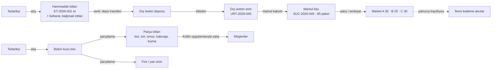

# Proje Analizi — AVATAR Yapay Zekâ Yarışması

| | |
|---|---|
| Sürüm | v0.2 (ekip cevapları işlendi: takım adı, teslim adresi, Go yerine Kotlin/Python, gerçek veri yok) |
| Tarih | 24 Ekim 2026 (Cumartesi) |
| Durum | Taslak — bazı sorular hâlâ açık (§7) |
| Kaynaklar | `_kaynak/AVATAR_Assessment.pdf` (3 sayfa, şartname; üç e-postadaki kopyaları birebir aynı), `_kaynak/yarisma_eposta.md` (üç e-posta ve geçerli teslim kuralı) |
| İlgili belgeler | `requirements.md` (gereksinim kimlikleri), `testing_strategy.md`, `development_plan.md` |

**İşaretler.** Bu belgede her bilginin nereden geldiği ayrılır:

- **[Belge]** Şartnamede veya e-postada açıkça yazıyor.
- **[Çıkarım]** Belgeden mantıkla çıkardığımız sonuç; belgede birebir yazmıyor.
- **[Varsayım]** Cevap gelene kadar kabul ettiğimiz değer; değişebilir (listesi `requirements.md` → AS-xxx).
- **[Belirsiz]** Belgeden çıkarılamıyor; soru listesinde (§7).

---

## 0. Bir bakışta

**Ne yapacağız?** Bir gıda işletmesi için hammaddenin alışından nihai satışına kadar her kilogramı **lot (parti) numarasıyla** izleyen; stok hareketlerini, **gerçek maliyeti** ve **geri çağırmayı** yöneten bir sistem. Parçaları: merkezi sunucu + MySQL, web yönetim ve raporlama ekranları, Kotlin ile yazılmış Android satış uygulaması (yerelde SQLite), iki yapay zekâ modeli (üretim verimi/EKP tahmini, parçalama verimi tahmini). **[Belge]**

**Neden böyle?** Değerlendirme odağı beş maddedir: doğru maliyet hesabı, eksiksiz lot ilişkileri, güvenilir stok hareketleri, kullanılabilir Kotlin uygulaması, ölçülebilir yapay zekâ katkısı **[Belge]**. İlk üçü aslında tek bir şeye bağlıdır: **veri modelinin doğruluğu**. Gösterişli ekranlar bu eksikleri kapatmaz. Belgenin alt başlığı "Yazılım Geliştirici **Aday Değerlendirme** Projesi"dir; yani kod kalitesi, tutarsızlıkları fark etme ve kararları gerekçelendirme de büyük olasılıkla puanlanıyor **[Çıkarım]**.

**Nasıl yapacağız?** Önce üç görevin ortak çekirdeğini kuracağız: (1) silinmeyen, yalnızca eklenen bir **stok hareket defteri**, (2) lotlar arası miktarlı **ilişki ağı** (çoktan çoğa), (3) ondalık hassasiyetli **maliyet motoru**. Görev 1 → 2 → 3 bu çekirdeğin üstüne uçtan uca küçük parçalar (dikey dilimler) olarak eklenir. Android uygulaması ve yapay zekâ çalışması paralel ilerler. İsteğe bağlı özellikler ancak temel sistem test edilip çalıştıktan sonra ele alınır.

**Başarılı olduğumuzu nasıl doğrulayacağız?** Şartnamenin kendi rakamlarını otomatik kabul testlerine çeviririz: EKP = **18,16 €**, ET-2026-001'den etkilenen marketler = **A 30 / B 25 / C 30 paket**, parçalamada **dağıtılan maliyet toplamı = toplam maliyet**. Bunlara stok defteri testleri (stok = hareketlerin toplamı, negatif stok yok, aynı satış iki kez gelse tek kayıt), yapay zekâ için "basit referans yönteme göre hata" ölçümü, temiz bir bilgisayarda README ile kurulum denemesi ve 15 dakikalık demo provası eklenir. Ayrıntı: `testing_strategy.md`.

**En büyük risk:** Süre. Bugün 24 Ekim; teslim **1 Kasım 2026 23:59** → yaklaşık **8 gün**, beş ayrı teknoloji bileşeni. Plan bu yüzden "önce çalışan en küçük sürüm" üzerine kurulu (`development_plan.md`).

---

## 1. Projenin özeti

### 1.1 Amaç

Gerçek bir gıda işletmesinde kullanılabilecek, hammaddeden nihai satışa kadar maliyet ve stok hareketlerini yöneten bir uygulama. Üç ana görev ve iki zorunlu yapay zekâ çalışması **birbiriyle entegre** olmalı **[Belge]**. "Entegre" sözü, beş parçanın ayrı demolar değil, aynı veritabanı ve aynı lot/hareket altyapısı üzerinde çalışan tek bir sistem olması gerektiğini gösterir **[Çıkarım]**.

### 1.2 Kapsam bir bakışta

| # | Başlık | Tür | Öz |
|---|---|---|---|
| Görev 1 | Dış hizmetle üretim ve gerçek maliyet (EKP) | Zorunlu | Hammaddeyi fason üreticiye gönder, mamulü teslim al, birim maliyeti hesapla |
| Görev 2 | Bütün kuzu parçalama ve Kotlin ile satış | Zorunlu | Bir kuzuyu parçalara ayır, maliyeti parçalara dağıt, parçaları Android'den sat |
| Görev 3 | Parti/lot izlenebilirliği ve geri çağırma | Zorunlu | Sorunlu lotun gittiği her yeri bul, ürünleri bloke et, iletişim listesi çıkar |
| YZ-A | Üretim verimi ve EKP tahmini | Zorunlu | Geçmiş üretimlerden beklenen mamul miktarı ve birim maliyet |
| YZ-B | Parçalama verimi tahmini | Zorunlu | Hayvan türü ve ağırlıktan beklenen parça ağırlıkları |
| Bonus | Fatura/irsaliye okuma, anomali uyarıları | İsteğe bağlı | Öneri + insan onayı; beklenmeyen durumları işaretleme |

### 1.3 Kavramlar (ekip için kısa sözlük)

| Terim | Anlamı bu projede |
|---|---|
| **Lot / parti / Charge** | Aynı kaynaktan, aynı anda gelen veya üretilen ürün grubu (ör. ET-2026-001). "Charge" Almancada partidir **[Çıkarım]**. |
| **Dış hizmetle üretim (fason)** | Hammadde işletmenindir; dış üretici yalnızca işçilik/hizmet bedeli faturalar **[Belge]**. |
| **EKP** | Şartnamede "Gerçek Maliyet (EKP)" olarak geçiyor: mamulün **gerçek birim maliyeti** **[Belge]**. Kısaltma açılmamış; Almanca ticari dilde EK(P) = *Einkaufspreis* (maliyet/alış fiyatı), VK(P) = *Verkaufspreis* (satış fiyatı) anlamına gelir. Belgede "Charge", "KI" gibi Almanca terimler de geçtiği için bu yorum güçlü **[Çıkarım]**. |
| **VKP** | Satış fiyatı **[Çıkarım, yukarıdaki gerekçeyle]**. |
| **Brüt kâr / marj** | Brüt kâr = VKP − EKP. Marj = brüt kâr / VKP **[Varsayım AS-002]**; maliyet üzerinden hesaplanan "kâr oranı" ile karıştırılmamalı. |
| **Fire** | Değeri olmayan kayıp (kesim kaybı, kuruma vb.). |
| **Yan ürün** | Ana ürün olmayan ama değeri olabilen çıktı (kemik, sakatat, yağ). |
| **Dağıtım anahtarı** | Ortak maliyetin (bütün kuzu) parçalara hangi ölçüyle bölüneceği: miktar ağırlıklı ya da değer ağırlıklı **[Belge]**. |
| **İleriye / geriye izleme** | Hammaddeden müşteriye doğru / mamulden tedarikçiye doğru lot zincirini takip etme **[Belge]**. |
| **SKT** | Son tüketim tarihi **[Belge]**. |

---

## 2. Çözülmesi gereken problem

Bir gıda işletmesi aynı anda üç soruya **kesin** cevap verebilmelidir:

1. **"Bu ürün bize gerçekte kaça mal oldu?"** Hammadde bizim, işçilik dışarıda; ya da tek bir kuzudan farklı değerde beş parça çıkıyor. Ortalama veya tahmini değil, kullanılan lotların gerçek fiyatından hesaplanan maliyet gerekir.
2. **"Elimde ne var, nereye gitti?"** Her kilogramın hangi depoda, hangi lotta olduğunu ve geçmişte nasıl hareket ettiğini kanıtlanabilir biçimde bilmek gerekir.
3. **"Bu parti sorunluysa kimi aramalıyım?"** Bir et lotunda kalite sorunu çıktığında o etin girdiği bütün mamulleri, stokları, sevkiyatları ve alıcıları dakikalar içinde bulup satışı durdurmak gerekir. Bu, gıda güvenliğinde yasal bir zorunluluktur (ör. AB'de 178/2002 sayılı Tüzük'ün "bir önceki/bir sonraki halka" izlenebilirlik kuralı) **[Çıkarım; şartnamede mevzuat adı geçmiyor]**.

Bu üç sorunun ortak kökü aynıdır: **her fiziksel hareketin lot, miktar ve maliyetle birlikte, sonradan değiştirilemez biçimde kaydedilmesi.** Yapay zekâ ise bu kayıtların üstünde "olması beklenen"i tahmin eder; izlenebilirlik sonuçlarına karışmaz **[Belge]**.

### 2.1 Kavramsal akış

Aşağıdaki şema mimari değil, **iş akışı**dır. Her ok lot ve miktar taşıyan bir stok hareketi, her kutu bir süreçtir; süreçler girdi lotlarını çıktı lotlarına miktarıyla bağlar.

---

## 3. Şartnamenin madde madde değerlendirmesi

Her satırda: şartnamenin ne dediği (kısaltılmış), uygulamada ne anlama geldiği ve ilgili gereksinim kimliği (`requirements.md`).

### 3.1 Amaç bölümü

| Madde | Uygulamada anlamı | Gereksinim |
|---|---|---|
| Hammaddeden nihai satışa kadar maliyet ve stok hareketleri **[Belge]** | Alış, transfer, üretim, parçalama, satış, iade, fire — hepsi aynı hareket defterine yazılır. | NFR-002, FR-303 |
| Üç görev ve iki YZ çalışması entegre **[Belge]** | Ayrı ayrı demo yetmez. Görev 1'in mamulü Görev 3'te izlenir; Görev 2'nin parçaları Android'den satılır; YZ tahminleri aynı üretim/parçalama ekranında gerçekleşenle yan yana görünür. | CR-011 |

### 3.2 Görev 1 — Dış hizmetle üretim ve gerçek maliyet (EKP)

**Senaryo [Belge]:** İşletme dış üreticiye 100 kg et, 2 kg baharat ve 5 kg bağırsak gönderir. Üretici 85 adet 1 kg Narin Sucuk teslim eder ve yalnızca 85 × 5,50 € hizmet faturası keser. Hammadde bedelleri bu faturada yoktur.

**Hesabın doğrulanması (bizim kontrolümüz):**

| Maliyet unsuru | Şartnamedeki tutar | Kontrol |
|---|---|---|
| 100 kg et × 9,70 € | 970,00 € | ✓ |
| 2 kg baharat × 24,00 € | 48,00 € | ✓ |
| 5 kg bağırsak × 11,60 € | 58,00 € | ✓ |
| 85 paket × 5,50 € hizmet | 467,50 € | ✓ |
| **Toplam / 85 paket** | **1.543,50 € / 85 = 18,16 €** | ✓ (tam değer 18,158823… €) |

Şartnamenin hesabı doğru. Ama uygulamada dikkat edilmesi gereken iki ince nokta var **[Çıkarım]**:

1. **Yuvarlama tuzağı.** 18,16 € × 85 = **1.543,60 €** eder; gerçek toplam **1.543,50 €**'dur (0,10 € fark). Stok değeri yuvarlanmış birim maliyetten geri hesaplanırsa sistem olmayan 10 sent "üretir". Çözüm: lotun **toplam değeri** esas tutulur, birim maliyet en az 4 ondalıkla (18,1588) saklanır, yalnızca ekranda 2 ondalık gösterilir; son satışta kalan kuruş farkı kapatılır (NFR-001).
2. **Hizmet bedeli adet başınadır.** EKP = hammadde maliyeti / adet + 5,50 € = 12,6588 + 5,50. Teslim edilen adet değişirse hizmet faturası da değişir. Bu, YZ-A'da EKP tahminini basitleştirir: belirsizliğin büyük kısmı **verimde** (kaç paket çıkacağı) yatar (§3.5).

Ayrıca verim tanımı belgede yok **[Belirsiz, S-08]**: et bazında 85 / 100 = **%85**, toplam girdi bazında 85 / 107 = **%79,4**.

| Madde | Uygulamada anlamı | Gereksinim |
|---|---|---|
| Hammaddeler işletmeye aittir; bedelleri hizmet faturasında yer almaz **[Belge]** | Sevk bir satış ya da satın alma değil, **depo transferidir**: mal bizim stokumuzda kalır ama "Dış üretici deposu"nda durur. Maliyet = kendi hammadde maliyetimiz + hizmet bedeli. | FR-106, FR-107 |
| Hammadde kartları, alış fiyatları, ölçü birimleri, lot numaraları ve stoklar yönetilir **[Belge]** | Ürün kartı + lot kaydı + depo bazlı lot stoku. Alış fiyatı **lot bazında** saklanır; aynı etin farklı lotları farklı fiyatlı olabilir ve "gerçek maliyet" kullanılan lotun fiyatından hesaplanır (ortalama fiyattan değil) **[Çıkarım]**. Ölçü birimi: kg ve adet/paket; Narin Sucuk 1 paket = 1 kg **[Belge]**. | FR-101–104 |
| Dış üretim emri, hammadde sevki, hizmet maliyeti, mamul kabulü ve miktar farkları kaydedilir **[Belge]** | Emrin durumları olur (ör. taslak → sevk edildi → teslim alındı → kapandı). "Miktar farkları" belgede tanımlanmamış **[Belirsiz]**; en az üç fark mümkün: planlanan ↔ teslim alınan mamul, sevk edilen ↔ tüketilen hammadde, üreticide artan hammaddenin iadesi. Üçünü de kaydedebilen bir yapı kuracağız **[Varsayım]**. | FR-105–109 |
| Gerçek mamul miktarına göre EKP hesaplanır; VKP, brüt kâr ve marj gösterilir **[Belge]** | EKP, planlanan değil **teslim alınan** miktara bölünür. VKP örnek değerde verilmemiş; demo için biz belirleyeceğiz **[Varsayım AS-005]**. | FR-110, FR-111 |
| Tüm maliyet ve stok hareketleri geçmişe dönük incelenebilir olmalıdır **[Belge]** | Hareketler silinmez ve güncellenmez; hata, ters kayıtla düzeltilir. Her EKP hesabının dökümü (hangi lottan kaç kg × hangi fiyat) saklanır ki "18,16 € nereden çıktı?" sorusu sonradan cevaplanabilsin. | FR-112, NFR-002, NFR-008 |

### 3.3 Görev 2 — Bütün kuzu parçalama ve Kotlin ile satış

| Madde | Uygulamada anlamı | Gereksinim |
|---|---|---|
| Bütün kuzu önceden tanımlı ürünlere (but, sırt, omuz, kaburga, kıyma vb.) parçalanır; reçete ve dağıtım anahtarı önceden tanımlanabilir, fiili ağırlıklar işlem sırasında kaydedilir **[Belge]** | İki katman: **reçete** = hangi parçaların hangi beklenen oranlarla çıkacağı; **işlem** = o gün gerçekte tartılan ağırlıklar. Reçetedeki oranlar YZ-B için doğal bir "basit referans yöntem"dir (§3.5) **[Çıkarım]**. | FR-201, FR-202, FR-204 |
| Giriş hayvanı/partisi, ağırlık, **gerçek toplam alış maliyeti** ve işlem tarihi kaydedilir **[Belge]** | "Gerçek toplam" vurgusu, maliyetin yalnızca "kg × birim fiyat" olmayabileceğini gösterir (nakliye, kesim ücreti gibi ek kalemler) **[Çıkarım]**. Maliyeti kalem kalem giriyoruz; toplam bu kalemlerden hesaplanır. | FR-203 |
| Parça ürünleri, miktarları, fire/yan ürünler ve ağırlık dengesi kontrol edilir **[Belge]** | Denge kuralı: giriş ağırlığı = parçalar + yan ürünler + fire (küçük bir tartım toleransıyla). Denge sağlanmadan işlem onaylanmaz; açıklanamayan fark sessizce kaybolmaz. | FR-204, FR-205 |
| Maliyet, seçilen miktar veya değer ağırlıklı anahtara göre dağıtılır; **toplam dağıtılan = toplam maliyet** **[Belge]** | Aşağıdaki örnekte görüldüğü gibi yuvarlama kuruş farkı üretir; bu fark kuralla (en büyük kalan yöntemi) dağıtılır ki toplam **kuruşu kuruşuna** tutsun. Fireye maliyet verilmez; fire maliyeti sağlam ürünlere yüklenir **[Varsayım AS-006]**. | FR-202, FR-206 |
| Oluşan ürünler lot bazında stoklanır ve Kotlin Android satış uygulamasından satılır **[Belge]** | Her parça için giriş lotuna bağlı yeni bir parça lotu açılır. Android bu lotları satar. | FR-208, FR-401 |

**İki dağıtım yönteminin farkı — kendi örneğimiz.** Şartnamedeki görsel elimizde olmadığı için (aşağıya bakın) rakamları biz seçtik; amaç yalnızca yöntemi göstermek. Toplam maliyet 351,00 €, parçalar toplam 22 kg, fire 3 kg (fireye maliyet yok). Değer ağırlıklı yöntemde değer = kg × parçanın satış fiyatı.

| Parça | kg | Örnek satış fiyatı (€/kg) | Miktar ağırlıklı pay | Değer ağırlıklı pay | Değer ağırlıklı €/kg |
|---|---|---|---|---|---|
| But | 7 | 22 | 111,68 | 123,41 | 17,63 |
| Sırt | 4 | 26 | 63,82 | 83,34 | 20,84 |
| Omuz | 5 | 18 | 79,77 | 72,12 | 14,42 |
| Kaburga | 3 | 14 | 47,86 → **47,87** | 33,66 | 11,22 |
| Kıyma | 3 | 16 | 47,86 | 38,47 | 12,82 |
| **Toplam** | **22** | | 350,99 → **351,00** | **351,00** | |

- **Miktar ağırlıklı** yöntemde her kilo aynı maliyeti (15,95 €/kg) taşır. Düz yuvarlama toplamı **350,99 €** yapıyor; 1 kuruşluk fark en büyük kalanı olan satıra eklenince 351,00 € tutuyor. Sistem bu farkı kendisi kapatmalı.
- **Değer ağırlıklı** yöntem pahalı parçaya (sırt) daha çok, ucuz parçaya (kaburga) daha az maliyet yükler. Böylece kıyma gibi ucuz ürünler yapay biçimde "zararda" görünmez. Muhasebede ortak ürün maliyetlemesinde yaygın yöntem budur **[Çıkarım]**.
- Hangisinin seçileceği işlem başına seçilebilir **[Belge]**; varsayılanı reçetede tanımlarız.

**Şartnamedeki tutarsızlık notu.** Şartname, adaydan bir "örnek görsel"deki iki tutarsızlığı tespit edip açıklamasını istiyor **[Belge]**:

- 25 kg × 11,50 € = 287,50 € eder; görselde **351,00 €** yazıyor.
- Görseldeki parça miktarları **22 kg** tutuyor; giriş 25 kg.

**Sorun: PDF'te hiç görsel yok.** Üç e-postayla gelen üç PDF kopyası birebir aynı dosya (aynı SHA-256 özeti) ve hiçbirinde gömülü görsel yok; sayfalarda yalnızca tablo çizgileri var. Görsele ancak organizatörden isteyerek ulaşabiliriz **[Belirsiz, S-01]**. Notta iki tutarsızlığın rakamları zaten verildiği için görselsiz de açıklama yapılabilir **[Çıkarım]**:

| Tutarsızlık | Olası nedenler | Sistemin vereceği cevap |
|---|---|---|
| 287,50 € ≠ 351,00 € (fark 63,50 €) | (a) 351,00 € "gerçek toplam alış maliyeti"dir ve kesim/nakliye gibi 63,50 €'luk ek masraf içerir; (b) birim fiyat yanlış yazılmıştır (351,00 / 25 = 14,04 €/kg); (c) ağırlık yanlış yazılmıştır (351,00 / 11,50 = 30,52 kg — küsuratlı, düşük olasılık). | Maliyet kalem kalem girilir. "kg × birim fiyat" ile fatura toplamı uyuşmazsa sistem uyarır ve açıklama ister (FR-207). |
| 22 kg ≠ 25 kg (fark 3 kg, %12) | Fire ve/veya yan ürün (kemik, yağ, kesim kaybı) kaydedilmemiştir. | Ağırlık dengesi kuralı farkı yakalar; fark fire ya da yan ürün olarak açıklanmadan işlem onaylanmaz (FR-205). |

Görsel bulunursa bu bölüm gerçek rakamlarla güncellenecek.

### 3.4 Görev 3 — Parti / lot (Charge) izlenebilirliği ve geri çağırma

**Zorunlu senaryo [Belge]:**

| Kayıt | Değer |
|---|---|
| Hammadde lotu | ET-2026-001 / 100 kg |
| Üretim emri | URT-2026-045 |
| Mamul lotu | SUC-2026-045 / 85 paket |
| Market A / B / C | 30 / 25 / 30 paket |

Kontrol: 30 + 25 + 30 = 85 ✓ → lotun tamamı sevk edilmiş, depoda kalan 0 **[Çıkarım]**. Senaryoda baharat ve bağırsak lot numaraları verilmemiş; Görev 1'deki üretimle aynı emir olduğu için onları biz tanımlayacağız ve geriye izlemede onlar da görünecek **[Varsayım AS-004]**.

**Beklenen sonuç (kabul testi AT-06):** ET-2026-001 sorgulandığında sistem şunu kesin olarak listelemeli: SUC-2026-045 → Market A 30 paket, Market B 25 paket, Market C 30 paket; depoda kalan stok 0; her market için sevkiyat belgesi ve iletişim bilgisi.

| Madde | Uygulamada anlamı | Gereksinim |
|---|---|---|
| Her hammadde girişine tedarikçi, lot no, tarih, miktar ve uygunsa SKT atanır **[Belge]** | Lot numarası olmadan giriş yapılamaz (veritabanında zorunlu alan). SKT isteğe bağlı alan; satışta "ilk biten ilk çıkar" sıralaması için de kullanılabilir. | FR-102 |
| Bir üretim emrinde birden çok hammadde lotu, bir hammadde lotu birden çok mamul lotuna; bu çoktan çoğa ilişkiler **miktarlarıyla** saklanır **[Belge]** | Merkezde bir "lot bağlantısı" tablosu: girdi lotu, çıktı lotu, kullanılan miktar, hangi süreç. Yalnızca "bağlı mı?" değil "ne kadar?" de saklanır; geri çağırmada etkilenen miktar buradan hesaplanır. | FR-302 |
| Parçalamada giriş lotundan oluşan bütün parça lotlarına izlenebilir bağlantı **[Belge]** | Parçalama da aynı lot bağlantısı yapısını kullanır; ayrı bir mekanizma kurulmaz (aynı kural, tek kod). | FR-208, FR-302 |
| Depo transferi, satış, iade, yeniden işleme ve fire lot bazında kaydedilir **[Belge]** | Hareket türleri listesi buradan çıkar. En az iki depo gerekir (ör. ana depo, dış üretici deposu, gerekirse satış aracı). "Yeniden işleme" bir lotun başka bir lota dönüşmesidir; o da lot bağlantısı üretir. İade, ürünü aynı lota geri getirir. | FR-303 |
| **İleriye izleme:** etkilenen bütün mamul lotları, stoklar, sevkiyatlar, bilinen alıcılar **[Belge]** | Lot ağında ileri doğru, çok adımlı gezinme (hammadde → mamul → yeniden işlenmiş mamul …), sonra her lotun satış/sevk hareketlerini alıcıya göre toplama. | FR-304 |
| **Geriye izleme:** mamul lotundan hammadde lotlarına, tedarikçilere ve üretim emirlerine **[Belge]** | Aynı ağda ters yön. | FR-305 |
| Geri çağırma ekranı etkilenen ürünleri **bloke eder**; müşteri/market bazlı miktar, sevkiyat ve iletişim listesi üretir **[Belge]** | Geri çağırma bir kayıt olarak açılır; kaynak lot ve ondan türeyen bütün lotlar "bloke" durumuna geçer. Liste dışa aktarılabilir olmalı (ör. CSV/yazdırılabilir) **[Çıkarım]**. Müşteri kartında iletişim bilgisi bu yüzden zorunlu. | FR-301, FR-306, FR-307 |
| İkinci kademe dağıtım yalnızca kaydedilmişse **kesin** olarak gösterilir **[Belge]** | Market A ürünü kendi şubelerine dağıttıysa ve bu kaydedildiyse "kesin", kaydedilmediyse "bilinen son alıcı: Market A; sonrası bilinmiyor" olarak ayrı gösterilir. Sistem asla tahminle alıcı uydurmaz. | FR-308 |
| Kotlin satış uygulamasında her satış satırının lotu, miktarı ve ilgili stok hareketi saklanır; geri çağrılan lotların satışı engellenir **[Belge]** | Bir satış satırı = bir lot = bir stok hareketi. Engelleme hem cihazda hem sunucuda yapılmalı; çünkü cihaz çevrimdışıyken geri çağırma başlamış olabilir. Bu durumun kuralı mimaride kararlaştırılacak (R-05). | FR-401, FR-403, FR-310 |

### 3.5 Zorunlu yapay zekâ çalışmaları

| Madde | Uygulamada anlamı | Gereksinim |
|---|---|---|
| **A — Üretim verimi ve EKP tahmini:** geçmiş üretim emirlerinden beklenen mamul miktarı ve birim maliyet; tahmin, gerçek sonuç ve sapma birlikte gösterilir **[Belge]** | Dış üretim emri açılırken "beklenen: ~84,6 paket, EKP ~18,22 €" gibi bir tahmin görünür; mamul kabul edilince gerçek değer ve sapma yan yana gösterilir. Hizmet adet başı olduğu için EKP tahmini, verim tahmininden ve bilinen lot fiyatlarından türetilebilir: EKP ≈ hammadde maliyeti / tahmini adet + hizmet birim ücreti **[Çıkarım]**. | FR-501, FR-502 |
| **B — Parçalama verimi tahmini:** hayvan türü, giriş ağırlığı ve geçmiş kayıtlardan beklenen parça ağırlıkları; gerçekle farklar raporlanır **[Belge]** | Parçalama ekranında her parça için "beklenen kg" ve tartım sonrası "fark". "Hayvan türü" ifadesi, verinin yalnız kuzu değil başka türleri de (ör. koyun, keçi) içerebileceğini düşündürüyor **[Çıkarım]**. | FR-503, FR-504 |
| Örnek/anonim veri, model yaklaşımı, **basit bir referans yöntemle karşılaştırma** ve **tahmin hata ölçümü** sunulmalı **[Belge]** | Teslim edilecekler: veri seti ve nasıl üretildiği, model açıklaması, referans yöntem, hata ölçüleri (ör. ortalama mutlak hata — kg ve € cinsinden — ve yüzde hata), test verisinde karşılaştırma tablosu. Doğal referans yöntemler: A için "ürün bazında geçmiş ortalama verim", B için "reçetedeki standart oran × giriş ağırlığı" **[Çıkarım]**. | FR-505, FR-506 |
| Gerçek veri azsa sınırlılıklar açıkça belirtilmeli **[Belge]** | Gerçek veriye sahip değiliz **[Varsayım AS-011, S-11]**. Sentetik veri kullanırsak model, veriyi üreten kuralları öğrenir; bu açıkça yazılmalı. Abartılı başarı iddiası değerlendirmede ters teper **[Çıkarım]**. | FR-507 |
| İzlenebilirlik ve geri çağırma sonuçları YZ tahminine değil, **kesin kayıt ilişkilerine** dayanmalı **[Belge]** | İzleme sorguları yalnızca kayıtlı lot bağlantılarını kullanır; hiçbir yerde "muhtemelen bu markete de gitmiştir" denmez. | CON-003 |

"Ölçülebilir yapay zekâ katkısı" **[Belge, değerlendirme odağı]** pratikte şu tabloyu göstermek demektir: *referans yöntemin hatası X, modelin hatası Y, iyileşme %Z* — aynı ayrılmış test verisi üzerinde. Model referansı geçemezse bunu da dürüstçe raporlayacağız.

### 3.6 İsteğe bağlı yapay zekâ özellikleri

| Özellik | Uygulamada anlamı | İlk değerlendirme **[Çıkarım]** |
|---|---|---|
| Fatura/irsaliye okuma: ürün, miktar, lot, maliyet **öneri** olarak çıkarılır, **insan onayıyla** kaydedilir **[Belge]** | Görüntü/PDF → metin → alanlar → onay ekranı. | Görüntüden metin okuma (OCR) veya dış bir dil modeli API'si gerektirir; dış bağımlılık, ücretli anahtar ve test zorluğu getirir. Puan katkısı belirsiz. **Düşük öncelik.** |
| Anomali uyarıları: beklenmedik fire, maliyet artışı, düşük üretim verimi, tutarsız lot hareketleri **[Belge]** | Kurallar + istatistiksel eşikler. | Zorunlu modellerin "tahmin − gerçek" farkını ve hareket defterini yeniden kullanır; ucuz ve sisteme doğal biçimde bağlanır. **Zaman kalırsa ilk bonus aday.** |

Bonuslar, temel sistem test edilip çalıştıktan sonra Aşama 10'da yeniden puanlanacak.

### 3.7 Teknik gereksinimler

| Bileşen | Şartname **[Belge]** | Bağlayıcılık | Not |
|---|---|---|---|
| Android satış/operasyon uygulaması | Kotlin | **Zorunlu** | Bu bilgisayarda Android Studio/SDK kurulu değil (§9, S-14). |
| Yerel veri | SQLite | **Zorunlu** | Android tarafında. Çevrimdışı çalışma açıkça istenmiyor ama "yerel saklama + senkronizasyon" bunu ima ediyor **[Çıkarım]**. |
| Merkezi veri | MySQL | **Zorunlu** | Docker ile çalıştırılabilir. |
| Backend ve API | Go **veya uygun modern teknoloji**; REST API | REST zorunlu, Go önerilen | Ekip Go bilmiyor; Python + FastAPI önerildi (ADR-001). |
| Web yönetim ve raporlama | React **veya uygun modern web teknolojisi** | Önerilen | React + Vite önerildi (ADR-002). |
| YZ servisleri | Uygun ML yaklaşımı ve **API entegrasyonu** | Zorunlu (yöntem serbest) | Model, sisteme API ile bağlanmalı; ayrı bir defter (notebook) yetmez **[Çıkarım]**. |
| Senkronizasyon | SQLite ↔ MySQL tutarlı senkronizasyon yaklaşımı **açıklanmalı** | Zorunlu | Hem belgelenecek hem çalışacak. |
| Raporlar | En az alış, üretim, parçalama, lot hareketleri, satış ve geri çağırma raporları **gösterilmeli** | Zorunlu | 6 rapor; demoda gösterilecek. |

### 3.8 Beklenen teslimat ve teslim koşulları

| Teslim edilecek | Kaynak | Gereksinim |
|---|---|---|
| Çalıştırılabilir prototip, kaynak kodu, kurulum açıklaması | Şartname §7 | CR-011, CR-001 |
| Veri modeli, API açıklaması, örnek kayıtlar, temel otomatik testler | Şartname §7 | CR-007–CR-010 |
| Üç görevin uçtan uca demosu; özellikle ET-2026-001'den etkilenen marketlerin bulunması | Şartname §7, e-posta | CR-002, CR-003 |
| YZ yöntemlerinin açıklaması, örnek tahminler, doğruluk değerlendirmesi | Şartname §7 | CR-006 |
| GitHub deposu (kod + README), teslimde **herkese açık** | E-posta | CR-001 |
| Demo videosu ≤ **15 dk**, bağlantıya sahip herkes izleyebilmeli (YouTube "liste dışı" veya Drive) | E-posta | CR-002 |
| **01.11.2026 23:59**'a kadar **ext.s.a.bakir@delta-ac.de** adresine, konu = takım adı (**Synera**), kayıtlı bir ekip üyesinin e-postasından. 20 Ekim tarihli e-postaya göre ilk e-postaya "yanıtla" ile gönderilenler ulaşmıyor; adres elle yazılmalı. | E-postalar 1–3 | CR-004 |
| Değerlendirme **teslim tarihindeki son commit** üzerinden | E-posta | CR-005 |

Saat dilimi belirtilmemiş **[Belirsiz, S-04]**: Delta-A'nın alan adı Almanya'ya ait (`.de`). 1 Kasım'da Almanya kış saatindedir (UTC+1), Türkiye UTC+3; yani Türkiye saatiyle 23:59, Almanya saatiyle 21:59'dur. **Daha erken olanı (Türkiye saati) esas alıyoruz** ve teslimi 1 Kasım öğleden sonraya planlıyoruz **[Varsayım AS-010]**.

### 3.9 Değerlendirme odağı

"Doğru maliyet hesabı, eksiksiz lot ilişkileri, güvenilir stok hareketleri, kullanılabilir Kotlin uygulaması ve ölçülebilir KI katkısı" **[Belge]** — strateji §6'da.

---

## 4. Yarışmanın bizden beklediği çıktılar

| # | Çıktı | Biçim (önerimiz) | Durum |
|---|---|---|---|
| 1 | Çalışan prototip | Tek komutla ayağa kalkan sunucu + veritabanı + web + YZ servisi; kurulabilir Android APK | Başlanmadı |
| 2 | Kaynak kodu | Herkese açık GitHub deposu | Başlanmadı |
| 3 | Kurulum açıklaması | `README.md` (adım adım, temiz bilgisayarda denenmiş) | İskelet var |
| 4 | Veri modeli | `docs/architecture.md` içinde ER diyagramı + tablo açıklamaları | Başlanmadı |
| 5 | API açıklaması | Uç noktaların makinece okunur tanımı + insan okunur özet | Başlanmadı |
| 6 | Örnek kayıtlar | `data/seed/` — şartname senaryolarıyla birebir | Başlanmadı |
| 7 | Temel otomatik testler | Birim + entegrasyon + kabul testleri | Plan var (`testing_strategy.md`) |
| 8 | Uçtan uca demo | Video ≤ 15 dk + yazılı demo senaryosu | Başlanmadı |
| 9 | YZ açıklaması ve doğruluk değerlendirmesi | `reports/` altında rapor + ekranda tahmin/gerçek/sapma | Başlanmadı |
| 10 | Senkronizasyon açıklaması | `docs/architecture.md` bölümü | Başlanmadı |
| 11 | Görev 2 tutarsızlık açıklaması | Bu belgede §3.3 (görsel gelirse güncellenecek) | Görselsiz taslak var |

---

## 5. Zorunlu gereksinimler ve kısıtlamalar (özet)

Tam ve kimlikli liste: `requirements.md`. Burada yalnızca **kritik** olanlar:

**Başarı için kritik zorunlu gereksinimler**

1. EKP'nin kullanılan lotların gerçek fiyatları ve gerçek mamul miktarıyla, kuruş hatası olmadan hesaplanması (FR-110, NFR-001).
2. Parçalamada ağırlık dengesi ve "dağıtılan maliyet toplamı = toplam maliyet" kuralı (FR-205, FR-206).
3. Bütün süreçlerde (alış, üretim, parçalama, yeniden işleme, transfer, satış, iade, fire) lot ve miktarın eksiksiz kaydı; çoktan çoğa lot bağlantıları (FR-302, FR-303).
4. İleri/geri izleme ve ET-2026-001 senaryosunun birebir sonucu (FR-304, FR-305, FR-309).
5. Geri çağırmada bloke etme ve bloke lotun hiçbir kanaldan satılamaması (FR-306, FR-310, FR-403).
6. Silinmeyen hareket defteri, işlem bütünlüğü, negatif stok olmaması (NFR-002–004).
7. Kotlin uygulamasıyla lot bazlı satış + SQLite + tutarlı senkronizasyon (FR-401, FR-404, FR-405).
8. İki YZ modeli + referans yöntem karşılaştırması + hata ölçümü + sınırlılıklar (FR-501–507).

**Kısıtlamalar**

| Kimlik | Kısıt | Kaynak |
|---|---|---|
| CON-001 | Süre: 24 Ekim → 1 Kasım 2026 23:59, yaklaşık 8 gün; 29 Ekim resmî tatil | E-posta, takvim |
| CON-002 | Kotlin, SQLite, MySQL zorunlu; REST API zorunlu | Şartname §6 |
| CON-003 | İzlenebilirlik/geri çağırma YZ'ye dayanamaz | Şartname §4 |
| CON-004 | Gerçek veri yok (öyle varsayıyoruz) → örnek/anonim veri | Şartname §4 |
| CON-005 | Video en fazla 15 dakika | E-posta |
| CON-006 | Depo herkese açık olacak → gizli bilgi ve yarışma belgeleri depoya girmez | E-posta |
| CON-007 | Geliştirme ortamı eksikleri (Android Studio/SDK yok, Docker kapalı, §9) | 24 Ekim tespiti |
| CON-008 | Ekip Go bilmiyor; sunucu tarafında Kotlin veya Python kullanılacak | Ekip cevabı, 24 Ekim |

---

## 6. Değerlendirme kriterleri ve strateji

| Kriter **[Belge]** | Ne anlama geliyor **[Çıkarım]** | Stratejimiz | Kanıt (nasıl göstereceğiz) |
|---|---|---|---|
| **Doğru maliyet hesabı** | Rakamlar şartnameyle birebir tutmalı; yuvarlama ve dağıtım farkları kaybolmamalı. | Kayan noktalı sayı yerine ondalık/kuruş tabanlı aritmetik; lot bazlı gerçek fiyat; dağıtımda kuruş farkı kuralı; her hesabın dökümü. | AT-01–AT-05 otomatik testleri; demoda 18,16 € ve dağıtım dökümü. |
| **Eksiksiz lot ilişkileri** | Hiçbir hareket lotsuz olmamalı; çoktan çoğa bağlar miktarıyla tutulmalı; çok adımlı izleme çalışmalı. | Lot bağlantısını veritabanında zorunlu kıl; tüm süreçler aynı "lot bağla" fonksiyonundan geçsin; yeniden işleme ve ikinci kademe dahil. | AT-06, AT-07, AT-09; demoda ET-2026-001 → A/B/C. |
| **Güvenilir stok hareketleri** | Stok sonradan "tutmaz" hâle gelmemeli; yarım kayıt, çift kayıt, negatif stok olmamalı. | Yalnızca eklenen hareket defteri, ters kayıtla düzeltme, her iş işlemi tek veritabanı işlemi, tekrar güvenli senkronizasyon. | AT-10, AT-11; lot stok mutabakat raporu. |
| **Kullanılabilir Kotlin uygulaması** | Gerçek bir satış elemanı az adımla, hatasız satış yapabilmeli; geri çağrılan lot net biçimde engellenmeli. | Az ekran, büyük düğmeler, lot önerisi (SKT'ye göre), anlaşılır Türkçe hata mesajları, çevrimdışı durum göstergesi. | AT-08, AT-12; ekipten biriyle kısa kullanılabilirlik denemesi; videoda gerçek akış. |
| **Ölçülebilir KI katkısı** | "YZ var" demek yetmez; sayıyla, referans yönteme göre katkı gösterilmeli. | Zaman sırasına göre ayrılmış test verisi; referans yöntem; hata ölçüleri; sınırlılıklar; tahminin ekranda gerçekle yan yana gösterimi. | AT-13; `reports/` altında değerlendirme raporu. |
| *(Örtük)* Kod ve belge kalitesi | "Aday değerlendirme" başlığı **[Çıkarım]** | Temiz, sade mimari; anlamlı commit'ler; kararların gerekçeli kaydı (`docs/decisions/`). | Depo yapısı, README, testler. |

---

## 7. Belirsiz konular ve cevaplanması gereken sorular

Öncelik: **K** = plan veya mimari buna bağlı, hemen gerekli; **O** = birkaç gün içinde gerekli; **D** = varsayımla ilerleyebiliriz.

| No | Soru | Neden önemli | Cevap / cevap gelene kadar varsayımımız | Önc. |
|---|---|---|---|---|
| S-01 | Görev 2'nin "örnek görseli" elinizde mi (önceki e-postalarda)? Yoksa organizatöre sorulsun mu? | Şartname bu görseldeki tutarsızlıkların açıklanmasını açıkça istiyor (CR-012). | **Kısmen cevaplandı (24 Ekim):** üç e-postanın PDF'leri aynı, hiçbirinde görsel yok. Organizatöre sorup sormamak ekibin kararı; o zamana kadar §3.3'teki görselsiz açıklama. | O |
| S-02 | Ekip kaç kişi? Kim hangi konuda deneyimli (Kotlin/Android, React, Python/ML)? Günde kaç saat ayrılabilir? 29 Ekim tatilinde çalışılacak mı? | İş bölümü ve kapsam doğrudan buna bağlı. | **Cevaplandı (24 Ekim):** ekip **2 kişi**; Kotlin, Python ve React/TypeScript biliniyor. Rol dağılımı önerisi: `development_plan.md` §4. Günlük ayrılabilecek süre açık. | O |
| S-03 | Backend için Go uygun mu? (Şartname Go'yu öneriyor ama "uygun modern teknoloji"ye de izin veriyor.) | Ekip Go bilmiyorsa 8 günde öğrenme maliyeti büyük risk. | **Cevaplandı:** ekip Go bilmiyor; Kotlin veya Python kullanılabilir. Seçim: `technical_research.md` D-01. | — |
| S-04 | Teslim saati Türkiye saati mi, Almanya saati mi? | 2 saat fark. | Daha erken olan Türkiye saati; teslim 1 Kasım öğleden sonra. | D |
| S-05 | Takım adı nedir, depo kimin GitHub hesabında açılacak, e-postayı kim gönderecek? | Depo ve teslim. Depoya her gönderimden önce size önizleme gösterip onay alacağım. | **Kısmen cevaplandı:** takım adı **Synera**; teslim adresi ext.s.a.bakir@delta-ac.de. GitHub hesabı ve e-postayı gönderecek kişi açık. | O |
| S-06 | Arayüz ve belge dili: yalnız Türkçe mi, Türkçe + İngilizce mi? | Delta-A bir Alman firması; şartname Türkçe. | Arayüz ve belgeler Türkçe, README'de kısa İngilizce özet; kod içi adlandırma İngilizce. | D |
| S-07 | Fiyatlar KDV hariç mi? Marj satış fiyatı üzerinden mi? | Gösterilecek kâr/marj rakamları. | Net fiyat, tek para birimi €; marj = brüt kâr / VKP. | D |
| S-08 | Üretim verimi hangi tanımla: mamul / et (%85) mi, mamul / toplam girdi (%79,4) mi? | YZ-A'nın hedef değişkeni. | İkisi de gösterilir; model et bazlı verimi tahmin eder. | D |
| S-09 | Market A/B/C'ye sevkiyat nereden kaydedilsin: Kotlin uygulamasından (saha satışı) mı, web'den irsaliye ile mi? | Görev 3 demosunun akışı ve Android kapsamı. | Kotlin uygulamasından satış olarak; böylece Görev 3 de Android'i kullanır. | O |
| S-10 | Kotlin uygulamasının "operasyon" kısmı ne kadar olsun: yalnız satış mı, parçalama tartım girişi / mal kabul de mi? | Android iş yükü. | Önce satış (zorunlu çekirdek); parçalama girişi zaman kalırsa. | O |
| S-11 | Elinizde anonim gerçek üretim/parçalama verisi var mı? | YZ değerlendirmesinin inandırıcılığı. | **Cevaplandı:** gerçek veri yok. Belgelenmiş varsayımlarla sentetik veri üretilecek; sınırlılık açıkça yazılacak. | — |
| S-12 | İsteğe bağlı YZ özelliklerini hedefliyor muyuz? Fatura okuma için ücretli bir dış API anahtarı kullanmak kabul edilebilir mi? | Bonus kapsamı ve maliyet. | Yalnız anomali uyarıları, o da zaman kalırsa. | D |
| S-13 | Test için gerçek bir Android telefon var mı? | Video ve kullanılabilirlik. | Emülatör. Bu bilgisayarda Android Studio ve SDK kurulu değil (§9). | D |
| S-14 | Android geliştirme hangi bilgisayarda yapılacak? Bu bilgisayara Android Studio + SDK kurulsun mu (birkaç GB indirme)? | Kritik yoldaki Android işi (T-13) ortama bağlı. | **Cevaplandı (24 Ekim):** bu bilgisayara kurulacak; şimdilik her şey bu bilgisayarda yapılıyor. | — |
| S-15 | Ekipte React / TypeScript bilen var mı? | Web arayüzü teknolojisi (D-02). | **Cevaplandı (24 Ekim):** var; web TypeScript ile yazılıyor. | — |
| S-16 | Kod ne zaman GitHub'a gönderilecek? | Teslim herkese açık depo istiyor; değerlendirme son commit üzerinden. | **Cevaplandı (24 Ekim):** proje bitene kadar her şey bu bilgisayarda; GitHub'a proje sonunda gönderilecek. Öneri: yerel git ile anlamlı commit'ler; gönderim teslimden en az bir gün önce. | — |
| S-17 | MySQL yerine PostgreSQL kullanılabilir mi? | Merkezi veritabanı seçimi. | **Cevaplandı (24 Ekim):** Hayır, önerilmez. Şartnamenin teknik tablosunda backend ve web satırlarında "veya uygun modern teknoloji" serbestliği var, "Merkezi veri saklama: MySQL" satırında yok **[Belge]**. E-postada da "MySQL (merkezi)" yazıyor; senkronizasyon "SQLite ve MySQL arasında" diye tanımlanıyor **[Belge]**. Başka bir veritabanı "teknik gereksinim karşılanmadı" diye puan kaybettirebilir. Tasarımda PostgreSQL'e özgü bir ihtiyaç yok. Organizatöre sorulup yazılı izin alınmadıkça MySQL. | — |

Belgede tanımlanmamış ama tasarımda karar vereceğimiz konular (ekip görüşü alınır, varsayılanı biz öneririz): kullanıcı rolleri ve giriş, yan ürünlerin maliyet payı, tartım toleransı, iade edilen geri çağrılmış ürünün akışı, çevrimdışıyken geri çağrılmış lot satılırsa ne olacağı.

---

## 8. Başarı için kritik teknik konular ve riskler

### 8.1 Kritik teknik konular

1. **Para ve miktar hassasiyeti.** Ondalık aritmetik, tanımlı yuvarlama, kuruş farkı dağıtımı (§3.2, §3.3).
2. **Hareket defteri.** Stok = hareketlerin toplamı; hareketler değişmez; her iş işlemi tek veritabanı işlemi.
3. **Lot ağı.** Çoktan çoğa, miktarlı, çok adımlı; ileri/geri izleme sorguları (MySQL 8'in özyinelemeli sorguları buna uygun — Aşama 4'te doğrulanacak).
4. **Senkronizasyon.** Android'de oluşan satışların sunucuya bir kez ve tam olarak ulaşması; geri çağırma bilgisinin cihaza hızla inmesi; çakışma kuralları.
5. **YZ değerlendirme düzeni.** Veri üretimi, zaman bazlı ayırma, referans yöntem, hata ölçüleri, sisteme API ile bağlanma.
6. **Kurulabilirlik.** Değerlendiricinin sistemi kendi bilgisayarında az adımla çalıştırabilmesi.

### 8.2 Riskler

| No | Risk | Olasılık | Etki | Önlem |
|---|---|---|---|---|
| R-01 | **Süre yetmez** (8 gün, 5 bileşen) | Yüksek | Yüksek | Önce çalışan en küçük sürüm; dikey dilimler; 31 Ekim akşamı kod dondurma; bonus en son; her gün sonunda durum kontrolü. |
| R-02 | Parasal hesap hataları (kayan nokta, yuvarlama) | Orta | Yüksek | Ondalık tipler; şartname rakamlarıyla birim testleri; dağıtımda toplam eşitliği testi. |
| R-03 | Stok tutarsızlığı (yarım işlem, çift kayıt, negatif stok) | Orta | Yüksek | Veritabanı işlemleri, kısıtlar, tekrar güvenlik anahtarı, mutabakat testi. |
| R-04 | Lot bağında eksik halka | Orta | Yüksek | Lot alanını zorunlu kıl; tek ortak lot bağlama fonksiyonu; izleme kabul testleri. |
| R-05 | Çevrimdışı senkron çakışması (ör. cihaz çevrimdışıyken geri çağrılan lot satıldı) | Orta | Orta | Sunucu tek doğru kaynak; satış fiziken gerçekleştiyse kaydedilir ama uyarı üretir ve geri çağırma listesine eklenir; senkron öncesi lot durumu çekilir. Kural mimaride kesinleşecek. |
| R-06 | Android derleme ortamı (bu bilgisayarda Android Studio ve SDK yok) | Yüksek | Yüksek | Android'i yapacak bilgisayarı hemen belirle (S-14); ilk gün boş proje + SQLite + sunucuya istek denemesi; APK'yı erken üret. |
| R-07 | YZ katkısının sentetik veriyle "yapay" görünmesi, aşırı öğrenme | Yüksek | Orta | Dürüst raporlama; referans yöntem; zaman bazlı ayırma; veri üretim varsayımlarının açık yazılması. |
| R-08 | Ortam: Docker Desktop kapalı; bu bilgisayarda daha önce Windows Uygulama Denetimi scikit-learn'ü engelledi (numpy ve pandas ise çalışıyor) | Orta | Orta | Sunucu ve YZ kodu Docker'daki Linux konteynerinde çalışır (ADR-007); kurulumlar T-05'in ilk işi. Go artık gerekmiyor (ADR-001). |
| R-09 | Değerlendirici kurulumu başaramaz | Orta | Yüksek | Tek komutla çalıştırma, otomatik örnek veri, temiz klonda deneme, hazır APK. |
| R-10 | Eksik görsel nedeniyle CR-012'nin eksik kalması | Yüksek | Düşük–Orta | Ekipten/organizatörden görseli iste; yoksa görselsiz açıklama + sistem kontrolleri. |
| R-11 | Video 15 dakikaya sığmaz | Orta | Orta | Yazılı demo senaryosu, zamanlı prova. |
| R-12 | Herkese açık depoda gizli bilgi sızıntısı | Düşük | Yüksek | `.env.example`, `.gitignore`, gönderim öncesi tarama. |
| R-13 | Aşırı mühendislik (gereksiz servis/katman) | Orta | Orta | Tek backend + tek YZ servisi; her ek parça için gerekçe kaydı. |

---

## 9. Ortam durumu (24 Ekim 2026, bu bilgisayar)

Yalnızca bu bilgisayar kontrol edildi; ekip üyelerinin ortamları bilinmiyor.

| Araç | Durum |
|---|---|
| Node.js / npm | v22.23.2 / 10.9.8 — kurulu |
| Python | 3.12.10 — kurulu; numpy 2.5.3 ve pandas 3.0.6 içe aktarılabiliyor; scikit-learn, FastAPI, SQLAlchemy kurulu değil (Uygulama Denetimi riski, R-08) |
| Git / GitHub CLI | 2.55 / 2.102 — kurulu |
| Docker | 29.8.2 kurulu; Docker Desktop ve WSL2 dağıtımı (`docker-desktop`) var ama **kapalı** (açılması gerekiyor) |
| Go | Kurulu değil — artık gerekmiyor (S-03) |
| MySQL | Kurulu değil (Docker ile çalıştırılacak) |
| Java / JDK | Yok |
| Android | **Android Studio kurulu değil** (kısayol `C:\Program Files\Android\Android Studio\bin\studio64.exe` dosyasını gösteriyor, dosya yok). Emülatör ayarları (Medium_Phone, Kilit_Pixel_A16) duruyor ama gösterdikleri SDK klasörü (`%LOCALAPPDATA%\Android\sdk`) **silinmiş**. |
